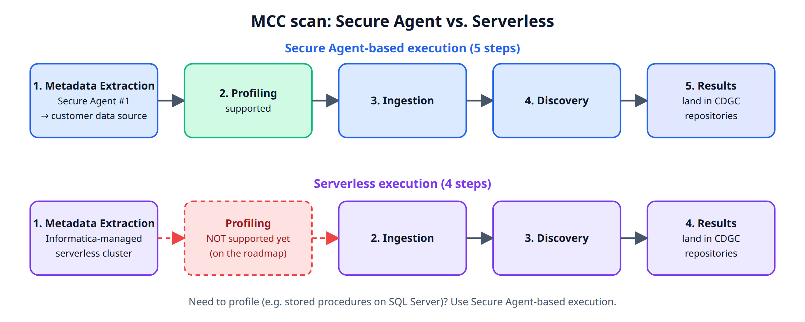
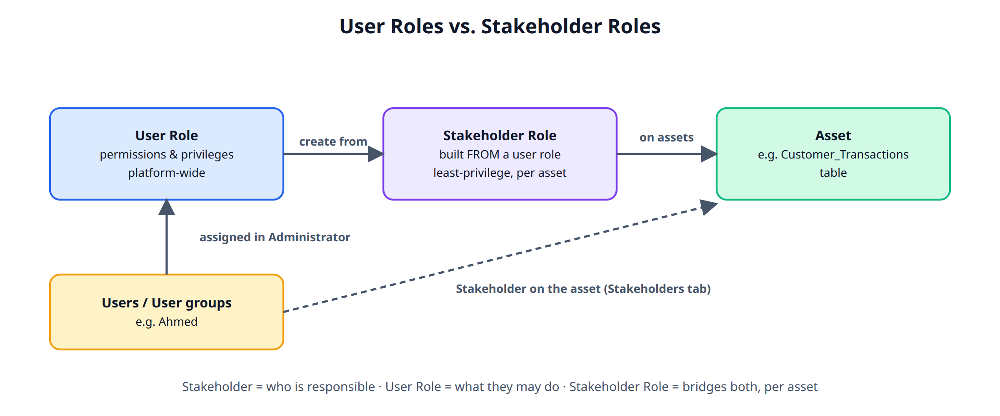
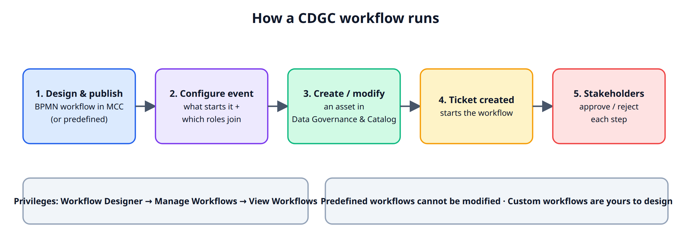
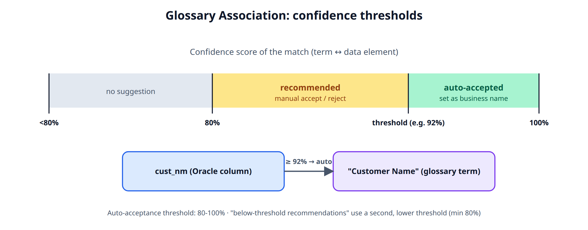
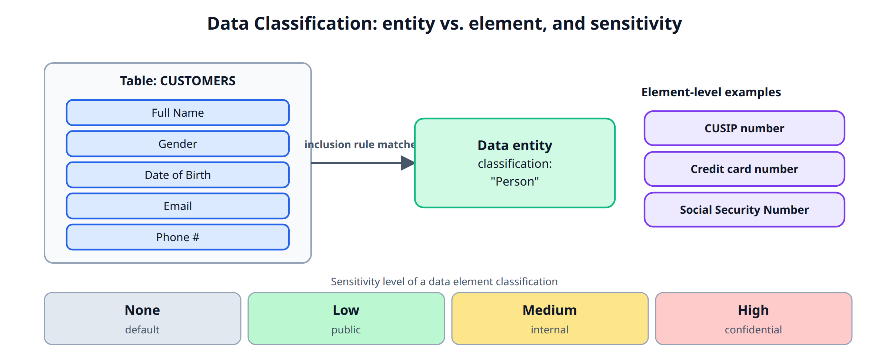
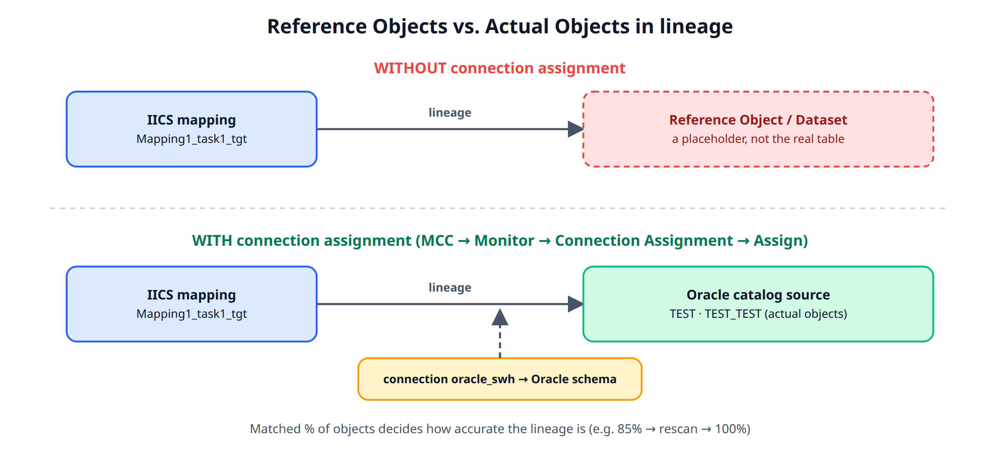
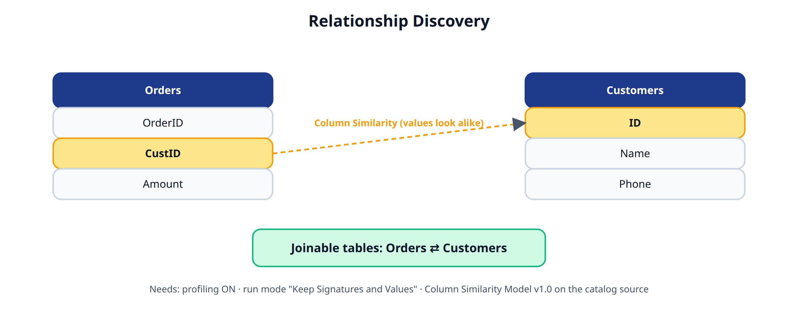
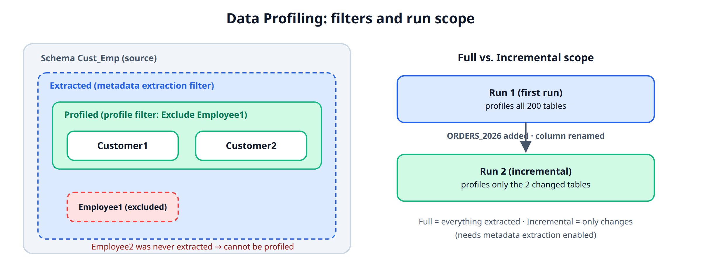
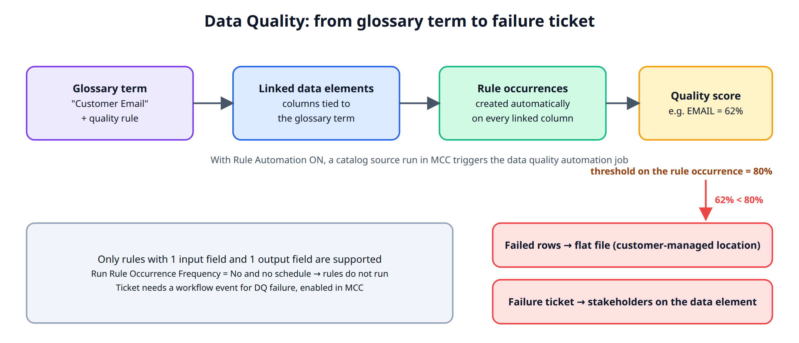
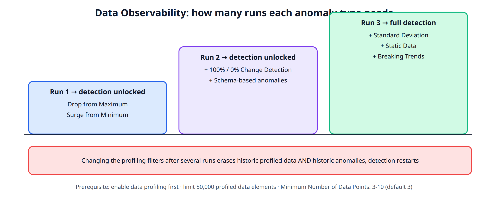

# IDMC / CDGC — Study Notes (Merged)
## ملاحظات المذاكرة المدمجة: Informatica IDMC و Cloud Data Governance and Catalog

**Owner:** Nour Shaaban · **Purpose:** IDMC job preparation · **Format:** bilingual (EN / AR) where the source notes were bilingual

---

## Contents / المحتويات

1. Metadata Command Center (MCC): Scanners & Execution Modes
2. Define Business Data (Data Sets)
3. Stakeholders & Roles
4. Workflows
5. Glossary Association
6. Data Classification
7. Connection Assignment & Lineage Discovery
8. Relationship Discovery
9. Data Profiling
10. Data Quality (catalog source)
11. Data Observability

---

# 1. Metadata Command Center (MCC): Scanners & Execution Modes

*Source: Informatica "Scanning and Data Discovery Best Practices" deck and MCC product docs.*

## Prerequisites before creating a catalog source
- Set up a runtime environment (Secure Agent or Serverless) for the org.
- Create a **Connection** to the source system in Administrator (Cloud Common Services). MCC references this connection; it does not store credentials itself.

## Registering a catalog source (general steps)
1. From My Services in IICS, open **Metadata Command Center**.
2. Click **New > Catalog Source**, then select the source type from the predefined systems (Oracle, SQL Server, Amazon S3, Redshift, Athena, SFTP File System, Informatica Developer, SSIS, etc.).
3. Click **Create**. On the Registration page, enter a name and an optional description (up to 4000 characters).
4. In **Connection Information**, pick the connection created earlier (the list is filtered to connections matching that source type).
5. Configure source-type-specific scanner parameters (e.g. SQL Server: the "Process Programmable Objects" toggle also scans stored procedures, functions and packages; SSIS: choose a file-based export or read directly from SSISDB).
6. Optionally set include/exclude filters (schemas, tables, folders) to scope the scan.
7. Optionally enable additional capabilities: Data Profiling and Quality, Data Classification, Relationship Discovery, Glossary Association, Connection Assignment.
8. Set a schedule or run on demand; jobs can also be triggered via API, specifying which capabilities to run.

- Renaming a catalog source only propagates to associated lineage objects if the metadata extraction job is rerun.

## Execution modes: Secure Agent-based vs. Serverless

**CDGC Secure Agent-based execution (5 steps)**
1. Metadata Extraction: runs on Secure Agent #1, connecting to the customer's cloud or on-prem data source.
2. Profiling: supported in this mode.
3. Ingestion.
4. Discovery.
5. Results land in the CDGC repositories.

- Uses Secure Agent(s) installed by the customer; a second Secure Agent can run as part of a serverless cluster component within this same mode.

**CDGC Serverless execution (4 steps)**
1. Metadata Extraction: runs inside an Informatica-managed serverless cluster (no customer-installed Secure Agent needed for this step).
2. Ingestion.
3. Discovery.
4. Results land in the CDGC repositories.

- **Key limitation:** Data Profiling is **not yet supported** in Serverless execution mode (listed as "on the roadmap" in the source deck).

**Practical example:** if the job requires profiling stored procedures on a SQL Server source, Secure Agent-based execution must be used, because Serverless mode currently skips the Profiling step entirely.

---

# 2. Define Business Data (Data Sets)

## Overview
- **Purpose:** assign business-friendly representations and meanings to cataloged technical assets such as DataSets and Systems, bridging the gap between technical metadata and business understanding.

## Data Set (asset type)
- A Data Set asset represents an identifiable grouping of data for a particular purpose. Data Sets are business-friendly representations of technical assets such as tables, files and more.
- Focus: less on how the data is delivered technically, more on the information and meaning the data set provides.
- **Example:** a table has the columns `cust_name` and `customer`. You can associate both columns with a single Data Set called "Customer Name" to give business context.
- You can **rate** a Data Set (quality assessment) and add **comments** to share input, which enables collaboration and collective decisions on using the data.
- You can view the number of **open tickets** (pending, tracking changes to the data set) and **overdue tickets** (past due date, requiring your action). You can also view the Data Set's lifecycle stage within the asset workflow.

## Data Set: Overview tab fields
| Field | Meaning |
|---|---|
| System | The parent system the data set belongs to. |
| Description | Description of the data set; the field can't exceed 1 MB. |
| Attributes | System and custom attributes of the asset. |
| Reference ID | Unique identifier for the data set. |
| Data Elements | Data elements added to this data set. |
| Stakeholders | Users responsible for, or interested in, the data set. |
| Asset Groups | One or more asset groups assigned to the asset, used to give users access to a set of assets. You can assign them if you're the stakeholder, or if the org admin granted you "Manage Access" via access policies in MCC. |
| Data Quality | Data quality scores for the data set, generated from a data quality tool. |
| Reference Data | Code values/attributes from Reference 360 linked to the data set. Needs the "View Reference Data" permission. |
| Associated Technical Data Sets | Data elements (tables, columns) associated with this data set. Can be associated at creation or afterward, but only data elements that belong to the catalog source associated with the parent System. |
| Data Marketplace | Shows the asset's presence in Data Marketplace (data collection details, if added). |
| Created By / Updated By | User and date of creation / last update. |

- If the org admin configured custom fields for the Data Set asset type, they also appear on the Overview tab.

---

# 3. Stakeholders & Roles / أصحاب المصلحة والأدوار

## Stakeholders / أصحاب المصلحة
- EN: Stakeholders are users or user groups that have access to assets in an organization. You associate assets with stakeholders in Data Governance and Catalog. The associated users/groups appear on the asset's **Stakeholders** tab. If a stakeholder is deleted, the page indicates it. To view the assets/policies associated with a user or group: **Access Control → Users tab**, select the user/group, then **Actions → Show Assets / Show Policies**.
- AR: أصحاب المصلحة (Stakeholders) هم المستخدمون أو مجموعات المستخدمين اللي ليهم صلاحية وصول لأصول (Assets) في المؤسسة. بتربط الأصول بأصحاب المصلحة في Data Governance and Catalog، وبيظهروا في تبويب Stakeholders الخاص بالأصل. لو المستخدم أو المجموعة اتمسحت، الصفحة بتوضح إنها محذوفة. عشان تشوف الأصول أو السياسات المرتبطة بمستخدم أو مجموعة، روح Access Control → تبويب Users، اختار المستخدم/المجموعة، وبعدين Actions → Show Assets أو Show Policies.
- **Example / مثال:** Ahmed is made a stakeholder (data owner) on the "Customer_Transactions" table, visible on that table's Stakeholders tab.

## User Roles / أدوار المستخدمين
- EN: A user role defines the permissions and privileges for different types of assets and features. Organization administrators create and assign user roles in Administrator. A role can be assigned to users or user groups.
- AR: الـ User Role بيحدد الصلاحيات والامتيازات لأنواع مختلفة من الأصول والميزات. مسؤول المؤسسة (Organization Administrator) هو اللي بيعمل ويخصص الأدوار دي من Administrator. الدور ده بيتحدد لمستخدمين أو مجموعات مستخدمين في المؤسسة.
- **Example / مثال:** the admin creates a "Catalog Steward" role with permissions to curate glossary recommendations and edit business names, then assigns it to Ahmed. This permission is platform-wide, unlike the asset-specific Stakeholder relationship.
- EN: View the access policies of a user role on the **Users** tab of **Access Control**: select the role, then **Actions → Show Policies**. See *User Administration* in Administrator for creating/assigning roles.
- AR: تقدر تشوف سياسات الوصول المرتبطة بالـ User Role من تبويب Users في Access Control: اختار الـ Role واضغط Show Policies من قائمة Actions.

## Stakeholder Roles / أدوار أصحاب المصلحة

- EN: A stakeholder role is a defined organizational responsibility that you declare on assets in Metadata Command Center. You create stakeholder roles **from user roles**. A user with a stakeholder role gets granular access to assets based on the access policies you configure. It reflects the user's responsibilities as a stakeholder of an asset and gives only the permissions needed for their governance tasks (**least privilege**). View a stakeholder role's policies/assets on the Users tab of Access Control: **Actions → Show Policies / Show Assets**.
- AR: الـ Stakeholder Role هو مسؤولية تنظيمية معرّفة بتحددها على الأصول في Metadata Command Center. بتعمل الـ Stakeholder Roles اعتمادًا على الـ User Roles الموجودة (يعني بتتبني منها). المستخدم اللي عنده Stakeholder Role يقدر يكون عنده وصول دقيق (granular) للأصول بناءً على سياسات الوصول اللي تحددها، وبيتديله بس الصلاحيات اللازمة عشان ينفذ مهام الحوكمة بتاعته (أقل صلاحية ممكنة).
- **Key distinction / الفرق الأهم:** a stakeholder role is built *from* a user role but scoped down to specific assets with fine-grained, least-privilege access. It bridges "who owns this asset" (Stakeholder) and "what can they actually do here" (User Role), applied per asset instead of platform-wide.

**Roles are categorized into user roles and stakeholder roles.**

---

# 4. Workflows

## Overview
- **Purpose:** design workflows and configure workflow events that services like Data Governance and Catalog can implement when users create or modify assets.
- A workflow orchestrates a sequence of steps to manage and approve organizational change, used to design and visualize changes and ensure compliance.
- Benefits: repeats steps in a clear, consistent manner; provides evidence that steps are followed every time (auditability).
- Built on **Business Process Modeling Notation (BPMN)** infrastructure, so you can design multi-step approval workflows in MCC.
- A workflow configured in MCC determines the business process to follow. **Workflow events** determine (a) what events can start the workflow and (b) which user roles can participate.

## What starts a workflow (tasks in Data Governance and Catalog)
- Creating a business or data access asset.
- Modifying the description or other editable properties on the Overview tab of a business asset.
- Modifying the description of a technical asset.
- Modifying editable properties on the Overview, Conditions, Rules, Techniques and De-identification Rank tabs of a data access asset.

## Stakeholders and steps
- A workflow includes the stakeholders who must provide input. Each step is a task a stakeholder of the asset must perform.
- It ensures the right people can provide input, challenge and approve changes. Human intervention is needed wherever a decision is required (e.g. approvals).
- **Trigger example:** when a user tries to create a business asset, Data Governance and Catalog creates a **ticket** for the approval process. The ticket starts the associated workflow and involves the relevant stakeholders.

## Predefined vs. custom workflows
- **Predefined:** a business process provided by Informatica; **cannot be modified**.
- **Custom:** a business process you design based on your organization's needs.

> **Removed feature:** effective the April 2026 release, Application Integration workflow events are no longer available in Metadata Command Center.

## High-level steps

1. Design and publish workflows in MCC, or use Informatica's predefined workflows.
2. Configure workflow events with the published workflows in MCC.
3. Create or modify assets in Data Governance and Catalog; this creates tickets, which start the workflow.

## Privileges for workflows
- Each workflow defines one or more specific user roles; who can participate depends on its steps and roles.
- Before designing workflows or configuring workflow events, assign **additional privileges** to existing user roles (modify existing roles, or create a separate role and assign it).
- The predefined **Governance Administrator Stakeholder** role in MCC already includes the features/privileges needed to configure and manage workflows. You also need at least one **access policy** granting permission to configure/manage workflows; the predefined *Governance Administrator Stakeholder* access policy does this.

| Task | Service / Feature | Privilege |
|---|---|---|
| Design workflows in MCC | Metadata Command Center / Access Metadata Command Center Application | **Workflow Designer** |
| Manage workflows and event configurations | Metadata Command Center / Access Metadata Command Center Application | **Manage Workflows** |
| View workflows in MCC | Metadata Command Center / Access Metadata Command Center Application | **View Workflows** (configured in Administrator) |
| Create workflow tickets in Data Governance and Catalog | MCC: Access Metadata Command Center Application + Read and Update permissions on the technical, business or data access asset types (via access policies). CDGC: Access Data Governance And Catalog Application | n/a |

- Summary: *Workflow Designer* (build) < *Manage Workflows* (manage workflows/event configs) < *View Workflows* (read-only visibility). Creating tickets separately needs MCC read/update permissions on the relevant asset types **and** access to Data Governance and Catalog itself.

---

# 5. Glossary Association

## Overview
- Lets you associate glossary terms with technical assets to give user-friendly business names to technical (system-level) assets.
- The capability either (1) **automatically associates** glossary terms with technical assets, or (2) **recommends** terms that you then manually associate in Data Governance and Catalog.
- It only associates terms with **data elements** (e.g. columns) and **technical data sets** (e.g. tables).
- To use it: select the **Glossary Association** capability in the catalog source Configuration wizard, which gives intelligent recommendations for the extracted technical assets.
- Workflow: after running it in MCC, you **curate** (accept/reject) the recommendations in Data Governance and Catalog.
- **Ambiguous source systems** (SAP BW, SAP BW/4HANA, SAP ERP, Salesforce) have unclear field names, so CLAIRE uses source context instead: SAP BW/BW4HANA/ERP use the extracted **Business Name** attribute; Salesforce uses the extracted **Label** attribute. (Same mechanism as CLAIRE-generated data classification.)
- You can also manually associate glossary **metric** and **business term** assets with data element and data entity **classifications**. To see these associations reflected, run the catalog source job with Glossary Association enabled *after* associating the glossary assets with the classifications.

## Configuration settings (Glossary Association tab)

Overall options: enable/disable auto-acceptance; set a confidence threshold for auto-acceptance; ignore prefix/suffix of a data element; use abbreviation/synonym definitions from a lookup table.

| Setting | Behavior |
|---|---|
| **Enable auto-acceptance** | Automatically accepts recommended terms and assigns them as business names to extracted data elements, based on the confidence threshold. If not selected, you accept/reject manually in Data Governance and Catalog. |
| **Confidence score threshold for auto-acceptance** | Percentage from **80 to 100** inclusive. |
| **Enable below-threshold recommendations** | Only available if auto-acceptance is on. Also gives recommendations *below* the auto-acceptance threshold (using a separate threshold); these still need manual accept/reject. |
| **Confidence score threshold for recommendations** | If auto-acceptance is on: from 80 up to the selected auto-acceptance threshold. If off: from 80 to 100 inclusive. |
| **Assign business names and descriptions** | Automatically assigns business names and descriptions. Sub-options: keep existing assignments and only fill assets without one (**default**), or allow overwriting. |
| **Ignore specified keywords** | Prefix/suffix values to ignore (case insensitive). If not selected, the whole data element name is considered. |

**Example:** an Oracle source has a column `cust_nm` and a glossary term "Customer Name". With auto-acceptance on and a 92% threshold, if "Customer Name" matches `cust_nm` with a score of at least 92%, it is auto-assigned as the business name in Data Governance and Catalog.

## Define the glossary association scope
- Choose specific **top-level business glossary assets** to associate with technical assets; selecting a top-level asset auto-selects its children.
- Steps: select "Top-level Glossary Assets" and specify the assets on the Select Assets page.
- After the catalog source job runs, these associations are **removed**: (1) any association not in scope for the currently selected glossaries; (2) all associations of a previously defined top-level asset that was deleted.
- **Exception:** if a previously defined top-level asset is no longer top-level (e.g. became a child) but still exists, its association is **retained**.

## Use abbreviation and synonym definitions
- Enable it to use a lookup table of abbreviations/synonyms to improve accuracy; upload the lookup synonym file with the **Select** button.
- Effect: finds more accurate matches, increases the confidence score for matching terms, prioritizes your synonyms, reduces false positives.
- **Without** the lookup table: `TRX_ID` could match "Transfer ID" or "Training ID"; `INV_DT` could match "Inventory Date" or "Invoice Date".
- **With** it: `TRX_ID` → "Transaction ID", `INV_DT` → "Invoice Date".

---

# 6. Data Classification

## Overview
- The process of identifying and organizing data into categories based on the functional meaning of the data; helps manage risk, compliance and data security.
- Enabled on a catalog source to identify and organize critical source data into meaningful categories.
- Types: **data element classification**, **data entity classification**, **document classification**, or AI-defined inclusion rules generated by **CLAIRE**.
- To create/manage classifications: in Administrator, define a role with the **Manage Data Classifications** feature privilege enabled for the Metadata Command Center service.

## Types of data classification

- **Data element classification:** the smallest unit; classifies columns, fields, structured and unstructured files. Labels information in data elements using metadata extracted from source systems plus facts from data profiling. *Example:* finding credit card numbers, Social Security Numbers or driver's license numbers, then securing access or setting privacy standards.
- **Data entity classification:** a data entity is a collection of data elements, derived from an inclusion scope. *Example:* if columns like Full Name, Gender, Date of Birth, Email and Phone # are found in a table, the table is classified as a **person** entity. Used for entities such as purchase order, invoice, customer, location, person, address.
- **CLAIRE-generated data classification:** see below.
- **Document classification:** see below.

## CLAIRE-generated data classification
- CLAIRE automatically generates classifications for data elements (no manual inclusion rules).
- Uses the **naming** of technical assets plus an embedded dictionary to generate potential labels.
- If "Generated Data Classification" is selected for a catalog source in MCC, generated classifications appear on the technical asset page in Data Governance and Catalog. You can **promote** one to a data element classification, or **reject** it. Once promoted, the system remembers it and auto-accepts it in future scans.
- **Data classification rules take precedence** over CLAIRE-generated classifications when both are used.
- Advantages: no inclusion rules to build; no need to know which predefined rule to pick; **no data profiling required** (rule-based classification with Statistics attributes does require profiling).
- Ambiguous sources (SAP BW, SAP BW/4HANA, SAP ERP, Salesforce): CLAIRE uses the **Business Name** attribute (SAP) or the **Label** attribute (Salesforce).

## Document classification
- AI-powered classification of **unstructured data** (PDFs, text files) into categories specific to the organization, based on the **content**, not just file name or metadata.
- Configured and run on a catalog source.
- Advantages: (1) search unstructured and structured assets together in one catalog; (2) fuels enterprise AI with well-categorized unstructured data; (3) helps find sensitive information hidden in documents for compliance.
- **Example:** a bank stores loan agreements, mortgage agreements and risk assessment reports as PDFs in Amazon S3. After scanning, they are auto-labeled "Loan Agreement", "Mortgage Agreement", etc.

## Creating a data element classification
- Can be created **with or without inclusion rules**. Rule-based classifications match patterns or asset names; one without rules just organizes data into org-specific categories.
- Rule-based: use the **Spark SQL-based expression language** in the MCC expression editor, or choose from **200+ predefined** rule-based classifications.
- Without rules: create it with no inclusion rules, then manually associate it with data elements in Data Governance and Catalog after metadata is ingested.

**Steps**
1. In MCC, click **New**.
2. Select **Data Classification** as the asset type.
3. Select **Data Element Classification**, click **Create**.
4. On **General Information**: enter a name (required) and an optional description. (Rule-less: skip the rule steps.)
5. In the **Sensitivity** panel, set the Sensitivity Level.
6. In the **Classification Category** panel, open the Category field.
7. Select one or more categories (a category groups classifications into business domains). With more than 10 categories, a "Select Classification Category" dialog appears (left: searchable list, right: selected items; OK to confirm).
8. Click **Next** to open the **Qualifier** tab.
9. In **Inclusion Rule**, build the expression from Attributes, Operators, Built-in Functions, Lookup Tables or Constants. Two modes: **Basic** and **Advanced** (type expressions with autocomplete). Expression values can't exceed **5000 characters**.
10. Click **Validate**; a success message appears if valid.
11. Click **Save**. Saved classifications appear on the Explore page, sorted by type.

## Sensitivity levels
| Level | Meaning | Examples |
|---|---|---|
| None (default) | Not sensitive; unrestricted | Widely accessible data |
| Low | Public | Public website content, company contact info |
| Medium | Internal | Emails/documents with no confidential data |
| High | Confidential | Financial, biometric, medical records, IP, authentication data |

- Levels can be customized per organization; if the UI differs from the docs, contact the administrator.

## How a classification gets applied
- **Rule-based:** enable the data classification capability on the catalog source and add the classification to its configuration. During the scan, inclusion rules classify metadata by matching names and content patterns. Results show in Data Governance and Catalog.
- **Both rule-based and rule-less:** you can also manually associate the published classification with data elements in Data Governance and Catalog after ingestion.

## Inclusion rule components
Inclusion rules are built from extracted metadata plus data facts from profiling, which makes classification **source-type independent**. If data profiling is **not** enabled, only metadata-based expressions can be used. Expressions use a Spark SQL-based language.

1. **Attributes:** metadata-based (column name, column comment, parent name, parent comment) and statistics-based (number of profiled values, frequent values, average of values profiled, etc.).
2. **Operators:** compare column values. Standard comparison operators (>, >=, =, <, <=) return **NULL** if either value is NULL/unknown.
3. **Built-in functions:** Lower, Upper, Trim, Size, Length, Substring, Forall, etc.
4. **Lookup tables:** check whether column values appear in an imported or published lookup table. Example: `NAME IN LOOKUP_TABLE.REFCOLUMN`. Predefined tables exist, or import your own.
5. **Constants:** a fixed value stored with a name to keep complex expressions readable. Scope is **local** to the rule that defines it. To define one, toggle **Advanced** mode in the Inclusion Rule section.
6. **Reference data:** use Reference 360 values to check whether they appear in the catalog source's data elements.

## Using Reference 360 data in a classification
1. In **Inclusion Rule** (Qualifier tab), select **Name** or **Frequent Value** from the Attribute list.
2. From **Operator**, select **Appears in Reference 360**.
3. Click **Browse** next to Values; the Select Reference Data dialog opens.
4. On **Select Code List**, pick the code list, click Next.
5. On **Select Attribute**, pick the attributes of the code values.
6. Click **Finish**.
7. For manual expressions, toggle **Advanced**.
8. From the top list, select **Reference Data**.
9. Expand the reference data, click the arrow next to attributes to add them to the editor.
10. Click **Validate**. If you select attributes with the same name from multiple code lists, all are validated but **only one is saved**.

---

# 7. Connection Assignment & Lineage Discovery / ربط الـ Connections واكتشاف الـ Lineage

*Source: Informatica Community article "CDGC Connection assignment - Concept, Do's & Don'ts and FAQ" and the CDGC docs.*

## What is a connection assignment?

- To generate lineage links to the **actual objects**, connections must be assigned to the corresponding schema/file path.
- Without it, lineage shows only **Reference Objects** (a reference placeholder), not the actual underlying objects.

## Example scenario
- In IICS, a mapping task (e.g. `Mapping1_task1_tgt`) has a source and a target. To validate the data flow you create two catalog sources:
  1. **Oracle:** the schema containing the tables referenced in the mapping (e.g. `TEST`, `TEST_TEST`).
  2. **IICS:** extracts the mapping itself.

## FAQ
- **Can you see lineage without a connection assignment?** Yes, but only as links between Reference Objects/Datasets, not Actual Objects.
- **How do you see Actual Objects?** Do the assignment: **MCC → Monitor → Connection Assignment**, select the connection (e.g. `oracle_swh [ICS_Sample]`), click **Assign**, and in the Assign Connection dialog select the Oracle (or other relational) source that holds the objects referenced by the mapping's connection.

## Creating a catalog source (recap)
5. After creating a connection in Administrator, go to MCC (tile-based launcher: Data Profiling, Data Quality, Metadata Command Center, Integration Hub, Mass Ingestion, Administration, Monitor, Spreadsheet Ingest).
6. In MCC: **New > Catalog Source** > choose the type (Amazon Athena, Redshift, S3, Apache Atlas, etc.) > **Create**.
7. Connections created in Administrator appear in the catalog source's Connection Information, filtered to the matching source type.

## Connections overview (assign / unassign) / نظرة عامة
- EN: To build and analyze lineage across catalog sources, assign or unassign objects to specific connections. Assignments define how objects in one catalog source relate to matching objects in another.
- AR: عشان تبني وتحلل الـ lineage بين الـ catalog sources، بتعمل assign أو unassign للـ objects على connections معينة. الـ assignment بيحدد إزاي الـ objects في catalog source ترتبط بالـ objects المطابقة في catalog source تاني.
- EN: Running a sync job on an **ETL catalog source** makes MCC extract its connections and create a **reference catalog source** (references from other source systems plus source-to-target table mapping).
- AR: لما تشغّل sync job على ETL catalog source، الـ MCC بيستخرج الـ connections وبيعمل reference catalog source فيه المراجع من الأنظمة التانية ومابينج الجداول.
- EN: To map accurately, manually assign connections from the reference catalog source to objects in the configured catalog source. MCC then links matching objects and shows the **percentage of matched vs unmatched objects**; this percentage determines lineage accuracy in Data Governance and Catalog.
- AR: بعد الـ assignment بيعمل links بين الـ objects المتطابقة ويعرض نسبة المتطابق مقابل غير المتطابق، والنسبة دي بتحدد دقة الـ lineage.
- EN: Assign/unassign on the **Assign Connections** tab of the **Configure** page, monitor jobs on **Monitor**, then verify lineage in Data Governance and Catalog. To fix failures, **rerun the assignment job**.
- AR: بتعمل assign/unassign من تاب Assign Connections في صفحة Configure، وبتتابع الـ jobs من Monitor. ولو في فشل، أعد تشغيل الـ assignment job.
- **Example:** syncing an IICS catalog source creates a reference catalog source with a connection to Oracle. You assign it to your Oracle catalog source; MCC reports 85% matched, and the 15% unmatched are tables missing from the scan. You rescan Oracle, rerun the assignment job, matched rises to 100%, and lineage reaches the real tables.

## Lineage discovery with CLAIRE / اكتشاف الـ Lineage بـ CLAIRE
- EN: Use CLAIRE to discover the complete lineage of catalog sources. After metadata extraction, lineage may be incomplete due to technological limitations or security constraints.
- AR: استخدام CLAIRE عشان تكمّل الـ lineage. أحياناً بعد استخراج الـ metadata الـ lineage بيطلع ناقص بسبب قيود تقنية أو أمنية.
- EN: To complete it, perform connection assignment from a reference catalog source connection to the endpoint objects in the reference source system (**Assign Connections** tab under the **Lineage** tab of **Configure**). Manual assignment is slow and error-prone, so CLAIRE **recommends** related catalog sources.
- AR: الحل إنك تعمل Connection Assignment من الـ connection بتاع الـ reference catalog source للـ endpoint objects. التعيين اليدوي بياخد وقت وفيه احتمال غلط، فـ CLAIRE بتقترح الـ catalog sources المرتبطة.
- **How to use CLAIRE:** (1) enable the **lineage discovery** capability when configuring the catalog source; (2) run the job, and MCC assigns reference connections to CLAIRE-recommended endpoint objects; (3) view the recommendations and **accept or reject** them.
- Sources without the capability show no recommendations; assign manually on the Assign Connections tab.
- For **relational database** sources you can also use the **Link Catalog Sources** tab (Lineage tab, Configure page): choose the source and target catalog sources to link.
- **Example:** an IICS mapping reads from an Oracle table but lineage stops at a "Reference Object". With lineage discovery on, CLAIRE recommends the Oracle catalog source; you accept and lineage now reaches the real table.

### Prerequisites to view CLAIRE recommendations / المتطلبات
1. EN: Define roles with the **Manage Lineage Settings** feature in IDMC Administrator (MCC privileges). AR: عرّف الـ roles وفعّل لها صلاحية Manage Lineage Settings.
2. EN: Verify metadata is extracted from the endpoint catalog sources. AR: اتأكد إن الـ metadata اتستخرجت من الـ endpoint catalog sources.
3. EN: Configure and run catalog sources with lineage discovery; optionally add **filters for lineage discovery** for better recommendations. AR: اعمل configure وشغّل الـ catalog sources بخاصية lineage discovery، وممكن تضيف فلاتر.
- **Example:** no recommendations appear because the Oracle source was never scanned (step 2) and the user's role lacked Manage Lineage Settings (step 1). Fixing both makes them appear.

### Curating CLAIRE recommendations / مراجعة التوصيات
- EN: After the run, view the related catalog sources with endpoint object recommendations, then accept or reject. CLAIRE computes the **percentage of matched and unmatched objects**; higher matched % means more accurate lineage.
- AR: CLAIRE بتحسب نسبة الـ objects المتطابقة وغير المتطابقة. كل ما النسبة المتطابقة أعلى، الـ lineage أدق.
- EN: Accept/reject each individually or in **bulk**. Accepting creates links between endpoint objects. Accepting also means **future recommendations are accepted**. A rejected recommendation can later be accepted.
- AR: تقبل أو ترفض كل توصية لوحدها أو مجموعة مرة واحدة. لما تقبل توصية، التوصيات المستقبلية كمان بتتقبل، والمرفوض ممكن تقبله بعدين.
- EN: Accepting starts the **connection assignment job** (check **Monitor**). Recommendations can become **outdated**; rerun the job with lineage discovery to refresh them.
- AR: القبول بيشغّل job الـ connection assignment. والتوصيات ممكن تبقى قديمة، فشغّل الـ job تاني.

**UI steps (Related Catalog Sources tab)**
1. On **Configure**, open the **Lineage** tab, then **Lineage Discovery**.
2. In the **Catalog Sources** panel, click **Add Filter** and add **Recommendations = True** (optionally filter by source type). Sources with recommendations show a **thunderbolt icon**.
3. Select a catalog source and open **Related Catalog Sources**.
4. Hover over a related source and click **Accept** or **Reject** from the Action menu; click its name for configuration details.
- After accepting, the assignment job runs; when it completes, the connection is assigned and MCC creates the links.
- **Example:** CLAIRE shows the Oracle source with 92% matched objects for an IICS mapping connection; you accept it, the job runs, and lineage reaches the real Oracle tables.

---

# 8. Relationship Discovery / اكتشاف العلاقات

## What it is
- EN: A capability for catalog sources that identifies pairs of similar columns and relationships between tables within a catalog source. It uses predictions from relationship inference models; the results are called **Inferred Relationships**.
- AR: خاصية في الـ Catalog Source بتكتشف أزواج الأعمدة المتشابهة والعلاقات بين الجداول جوه نفس الـ Catalog Source، والعلاقات الناتجة اسمها Inferred Relationships.

## Two types of inferred relationships

1. **Column Similarity:** semantically similar pairs of columns within a catalog source. / تحديد أزواج الأعمدة المتشابهة في المعنى.
2. **Joinable Tables Relationships:** tables that can be joined, based on the column similarity predictions. / تحديد الجداول اللي ينفع تتعمل بينها Join.

## How to enable it
- On the **Data Profiling and Quality** tab: enable data profiling.
- In **Parameters**: select **Keep Signatures and Values** as the run mode. This retains column values in the profiling results, which makes relationship discovery possible.
- AR: فعّل الـ Data Profiling واختار run mode = Keep Signatures and Values عشان قيم الأعمدة تتحفظ في نتايج الـ profiling.

## Use cases
- Recommend tables that can be joined with other tables.
- Assist cloud migration by analyzing related objects.

**Example:** a SQL Server catalog source has `Orders.CustID` and `Customers.ID` with different names but the same kind of values. With profiling on and Keep Signatures and Values, discovery flags the two columns as similar, then suggests Orders and Customers as joinable tables.

## Relationship inference model / نموذج الاستدلال
- EN: A predefined model made of user-defined rules and machine learning components that discovers relationships between columns within a catalog source; table-level relationships are inferred from the column similarity relationships.
- AR: نموذج جاهز مكوّن من قواعد يعرّفها المستخدم ومكونات machine learning، بيكتشف العلاقات بين الأعمدة ومنها بيستنتج العلاقات على مستوى الجداول.
- EN: MCC provides a predefined model called **Column Similarity Model v1.0**, which finds similar columns based on similarity among column values. You import it as predefined content and associate it with any catalog source.
- AR: الـ MCC بيوفر نموذج جاهز اسمه Column Similarity Model v1.0 بيلاقي الأعمدة المتشابهة بناءً على تشابه القيم.
- To associate the model: enable **Relationship Discovery** and set its parameters while creating the catalog source.

## Importing a relationship inference model
1. In MCC, open the **Explore** page from the left navigation panel. / افتح صفحة Explore.
2. Click the arrow icon at the top and select **Relationship Inference Model**. / اضغط السهم واختار Relationship Inference Model.
3. In the model window, click **Import**.
4. Click **Choose File** to pick the model file (or drag and drop). / اختار ملف النموذج.
5. Click **OK**; the model appears in the list. / النموذج بيظهر في القائمة.
- After importing, associate it with a catalog source when creating it (Relationship Discovery option).
- **Example:** import the Column Similarity Model v1.0 file once, then pick it when creating each new catalog source (SQL Server, Oracle, etc.).

---

# 9. Data Profiling / الـ Data Profiling

## Overview
- EN: Enable the data profiling capability to evaluate the quality of the metadata extracted from source systems. Profiling assesses the source metadata and collects **column data statistics** to discover content and structure: **value distribution, patterns and data types**. The statistics help the organization decide whether the data suits the business problem.
- AR: فعّل خاصية الـ data profiling عشان تقيّم جودة الـ metadata المستخرجة. الـ profiling بيجمع إحصائيات عن الأعمدة عشان يكتشف المحتوى والبنية: توزيع القيم، الأنماط (patterns)، وأنواع البيانات.

**How to use it / إزاي تستخدمه**
1. When creating a catalog source, select **Data Profiling** in the Configuration wizard. / اختار Data Profiling من الـ wizard.
2. Set the data profiling configuration options. / اضبط الخيارات.
3. Run the catalog source job; monitor the profiling task and see results on the **job overview** page. / شغّل الـ job وتابع النتايج من job overview.
4. View detailed statistics in **Data Governance and Catalog** by opening the catalog source asset (see *Asset Details*). / شوف الإحصائيات التفصيلية في CDGC.

**Example:** you scan an Oracle `CUSTOMERS` table with profiling on. The stats show the `PHONE` column has 12% nulls, a mix of two patterns (`01xxxxxxxxx` and `+20...`), and some values stored as text with letters. You decide it needs cleaning before it feeds a customer-contact report.

## Configuration options / خيارات الإعداد

- EN: After enabling Data Profiling, set options on the **Data Profiling** tab to control the type of data collected, the **scope** of the run and the **sample rows** profiled.
- AR: بعد ما تفعّل الـ Data Profiling، بتضبط الخيارات من تاب Data Profiling عشان تحدد نوع البيانات المتجمعة ونطاق الـ run والصفوف.

### Profile filters / فلاتر الـ Profile
- Filter conditions reduce the scope of a profiling task by creating subsets of the extracted metadata (e.g. extract six schemas but profile only three). Multiple conditions per catalog source are allowed; anyone with **create, edit or run catalog source** permission can configure them.
- Supported on all **relational and file system** catalog sources that support profiling.
- **Profile filters depend on metadata extraction filters:** you can only profile what was extracted.
- Types: **Include Metadata** (profile only the values in the condition) and **Exclude Metadata** (skip them).
- Examples: include the `Asia_Pacific` table in the `Customers` schema (Oracle); exclude the `Finance` table in the `EMPLOYEE` schema (Oracle); include/exclude the **external tables** object type with an asterisk wildcard (Amazon Athena); for file systems, include the `JAN2023` folder.
- **Example:** schema `Cust_Emp` has Customer1, Customer2, Employee1, Employee2. The extraction filter includes only Customer1, Customer2, Employee1. A profile filter can only pick among those three; adding Exclude on Employee1 leaves Customer1 and Customer2.

### Runtime environment / بيئة التشغيل
- EN: Select the runtime environment (a **Secure Agent**) for the profiling task. If none is selected, it runs on the one the org administrator chose when creating the connection. Profiling and data quality tasks can run on a **Windows Secure Agent configured with NTLMv2 proxy authentication**.
- AR: اختار الـ Secure Agent اللي هيشغّل الـ profiling task. لو ما اخترتش، بيشتغل على اللي الـ administrator اختاره وقت إنشاء الـ connection.
- **Example:** the admin set the Oracle connection to run on `Agent_Prod`; for a test scan you pick `Agent_Dev` so profiling doesn't load production.

### Mode of run / نمط التشغيل
| Mode | Collects |
|---|---|
| **Keep Signatures Only** | Aggregate info only (data types, average, standard deviation, patterns). **No data values.** |
| **Keep Signatures and Values** | Signatures plus actual values (minimum, maximum, frequent values, etc.). |

- **Example:** a sensitive `SALARY` column → Signatures Only (numeric, average, std deviation, nobody sees salaries). A non-sensitive `COUNTRY` column → Signatures and Values to see the most frequent values and min/max.

### Profile run scope / نطاق التشغيل
- **Full:** profiles the entire metadata extracted based on the extraction filters. / كل الـ metadata المستخرجة.
- **Incremental:** profiles only changed or updated metadata. / اللي اتغير بس.
- With incremental on, the **first run profiles everything**. Later runs detect changes (requires the **metadata extraction capability enabled**) and profile only those. E.g. rename a column after the first run: only that column's table is re-profiled.
- Changes it discovers: (1) a new object; (2) a renamed column; (3) objects not profiled in the previous run because of a **profiling task failure** or a **change in the metadata extraction filter**.
- **Example:** 200 tables; the first run profiles all 200. Next week `ORDERS_2026` is added and a column in `CUSTOMERS` is renamed: the next run profiles only those 2 tables.

### Source connection
- Select a connection to run profiling tasks on objects. Available **only for SAP ERP** catalog sources.

### Sampling type / نوع العينة
Options vary by catalog source type:

| Option | Behavior |
|---|---|
| **All Rows** | Profile all rows. |
| **Limit N Rows** | Profile a limited number of rows you specify. |
| **Random N Rows** | Profile a selected number of random rows. |
| **Random N Percentage** | Profile a percentage set in *Percentage of Data to Sample*. For Google BigQuery, tables are data blocks (e.g. 5% of data blocks). |
| **Custom Query** | A custom SQL clause in the *Sampling Query* field; syntax must match the database. |

- Examples: JDBC to **IBM DB2** with `FETCH FIRST 50 ROWS ONLY` profiles the first 50 rows; **Salesforce** with `employeeName like '%a%'` selects rows where employeeName contains "a".
- **Salesforce note:** you cannot use the **LIMIT** clause in a sampling query.
- **Example:** a 500-million-row `TRANSACTIONS` table: choose Random N Percentage at 1% for stats close to reality in far less time. For an Oracle table where only recent data matters, use Custom Query with a date condition.

### Elastic runtime environment and file-source options / بيئة الـ Elastic
- **Elastic runtime environment:** runs profiling on an **advanced cluster**, for complex files such as **AVRO and Parquet**. Only for **Amazon S3, Google Cloud Storage, Azure Data Lake Storage Gen2**. Cluster types: **Fully-managed** (multi-node serverless, scales with workload, lowest TCO) or **Local** (single node on the Secure Agent machine, for quick onboarding).
- **Staging connection:** only for elastic profile executions (Parquet/Avro on S3, ADLS Gen2, GCS); where results are stored **temporarily** during the job.
- **Maximum precision of string fields:** 1 to 255; default **50**.
- **Text qualifier:** character that defines string boundaries; if a quote is selected, delimiters inside the quotes are ignored; default **Double Quote**.
- **Code page for delimited files:** the code page the Secure Agent uses to read/write data, so non-English characters don't show junk; default **UTF-8**. Options: MS Windows Latin 1 (ISO 8859-1), UTF-8, Shift-JIS, ISO 8859-15 Latin 9, ISO 8859-2 Eastern European, ISO 8859-3 Southeast European, ISO 8859-5 Cyrillic, ISO 8859-9 Latin 5 (Turkish), IBM EBCDIC International Latin-1.
- **Escape character:** optional; makes the profile ignore a delimiter inside an unquoted string value. If set, it **overrides the default detected by the Metadata Extraction job**.
- Code page and Escape character are available **only** for Amazon S3, Google Cloud Storage and Azure Data Lake Storage Gen2 sources.
- **Example:** an S3 bucket holds Parquet files and a CSV of Arabic customer names. Parquet profiling runs on an elastic runtime with a staging connection; for the CSV, keep Double Quote so `"Cairo, Egypt"` isn't split at the comma, and use UTF-8 so Arabic displays correctly.

## Monitoring profiling tasks / متابعة الـ profiling
- EN: On the **job overview** page, monitor profiling status, view results and **retry** tasks that finish with errors. Results show **discovered, profiled, skipped and failed** object counts.
- AR: من صفحة job overview بتتابع حالة الـ profiling task وتشوف النتايج وتعمل retry للـ tasks اللي خلصت بأخطاء.
- A profiling task creates three subtasks: **Bulk ingestion**, **Task progress tracker**, **Batch profiling**.
- **Retry:** if a subtask completes with errors, hover over the profiling **parent task** and click **Retry Task**. A **new** task is created with **all failed objects** and run again with new batch profiling subtasks.
- The number of batch profiling subtasks depends on the object count and the max objects per batch, set by **mps_maxDeploymentBatchSize** of the **Metadata Platform Service** configured for a Secure Agent.
- **Logs:** per-object/task/subtask logs on the **Logs** tab; results on the **Results** tab.
- **Failed Session Logs:** downloads a ZIP named after the **catalog source job ID** (also in the URL of the Monitor tab). Extracted, it holds **one ZIP per failed batch profiling task**, each with session log files. Max saved session log files is **10**; the oldest is **overwritten**.
- For **partitioned objects**, *Objects Profiled Successfully* shows the total number of partitioned objects.
- **Example:** 300 discovered, 285 profiled, 5 skipped, 10 failed. Click Retry Task to re-profile just the 10 failed. If it fails again, download Failed Session Logs and read the log of the failed batch (e.g. a permission or connection problem).

---

# 10. Data Quality (catalog source) / الـ Data Quality في الـ catalog source

> Separate from the general IDMC Data Quality topics (Deduplicate, Rule Specification, Parse), which are not part of this merged CDGC file.

## Overview
- EN: Enable the **data quality capability** to generate **data quality scores** for metadata extracted from catalog sources. View the scores for assets in Data Governance and Catalog (CDGC).
- AR: فعّل خاصية الـ data quality عشان يتولّد score جودة للـ metadata المستخرجة، وبعدها تشوف الـ scores للـ assets في CDGC.

**How to enable it / إزاي تفعّله**
1. When creating the catalog source, select **Data Quality** in the Configuration wizard.
2. Set the data quality configuration options.
3. Run the catalog source job; monitor the data quality task status and results on the **job overview** page.
- View detailed scores by opening the extracted assets in CDGC (see *Asset Details*).

> **Important / ملحوظة مهمة:** data quality tasks run **only on assets that use rules with a single input field and a single output field**. / بتشتغل بس على الـ rules اللي عندها input field واحد و output field واحد.

**Example:** you scan an Oracle `CUSTOMERS` table with Data Quality on. The `EMAIL` column uses a rule with one input (email) and one output (valid/invalid), so it gets a quality score (e.g. 87%) visible on the column's page. A rule needing two inputs (e.g. country + phone code) isn't supported.

## Configuration options / خيارات الإعداد
- EN: Options decide the type of data collected, the scope of the run and the sample rows. After enabling Data Quality, set them on the **Data Profiling and Quality** tab.
- AR: بتضبط الخيارات من تاب Data Profiling and Quality.

### Runtime environment
- Select the **Secure Agent** for data quality tasks; if none, the one chosen by the org administrator for the connection is used. Can run on a **Windows Secure Agent configured with NTLMv2 proxy authentication**.

### Data Quality Rule Automation / أتمتة قواعد الجودة

- EN: Enable data quality automation for assets in the catalog source. When enabled and the catalog source job runs in MCC, a **data quality automation job** is triggered and **rule occurrences are created automatically**, associated with **all data elements linked to corresponding glossary business assets** in CDGC.
- AR: لما تفعّلها وتشغّل الـ catalog source job، بيشتغل data quality automation job وبيعمل rule occurrences تلقائياً ويربطها بكل الـ data elements المرتبطة بـ glossary business assets.
- **Example:** the glossary has a business term "Customer Email" with a quality rule attached, and several columns are linked to it. With Rule Automation on, one catalog source run creates the rule occurrence on every linked column instead of attaching it by hand.
- **Two scope options:** **Apply on data elements linked with business data set** (only data elements linked to business data sets) and **Apply on all data elements**.

**Result table (three settings):** *isAutomated* on the rule template in CDGC / *Data quality* option in MCC / *Data quality automation* option in MCC.

| isAutomated | Data quality | Automation | Result |
|---|---|---|---|
| Yes | Yes | Yes | Creates rule occurrences for all data elements associated with glossary business assets. |
| Yes | Yes | No | No new occurrences and no update; existing ones keep executing normally. |
| Yes | No | N/A | No occurrences created; **data quality execution stops** for existing occurrences on that catalog source's assets. |
| No | Yes | Yes | No occurrences created; existing ones are not affected. |

### Data Quality Remediation / معالجة الجودة الضعيفة
- Specify a **flat file connection** to store the list of **failed rows** so users can remediate poor scores. **No:** the *Create Data Quality Failure Ticket* option isn't enabled. **Yes:** shows flat file connections where failed rows are written to **customer-managed locations**.

### Data Quality Failure Ticket / تذكرة فشل الجودة
- Create tickets for poor scores based on the **threshold** defined on the rule occurrence in CDGC. **No:** no automatic tickets. **Yes:** tickets are created automatically by the thresholds you define in CDGC and you're notified when a score falls below.
- To remediate, configure a **workflow event for the data quality failure** and enable it in MCC. For automatic tickets, the **stakeholders in the Event Details tab must be added to the data element**.

### Cache Result / تخزين نتايج المعاينة
- **Agent Cache:** generates a cache file in the runtime environment so later previews are faster; cached **7 days** by default after the first preview run. Customize with **mps_previewFileRetentionInDays** in System Configuration Details of the **Metadata Platform Service** in Administrator.
- **No Cache:** live preview in CDGC, no caching.
- **Rerun the catalog source** whenever you change Cache Result from Agent Cache to No Cache.

### Connection (SAP)
- Select the **SAP Table connection** to run data quality tasks on **SAP ERP objects**.

### Run Rule Occurrence Frequency / تشغيل القواعد حسب التكرار
- **Yes:** rules run by the frequency configured on the rule occurrence in CDGC (a catalog source schedule doesn't affect it). **No:** disables that frequency; if no data quality schedule is set on the catalog source, the rules **don't run**.
- Make sure the data quality **schedule has not expired**; rules don't run if it has.

### Sampling type
- Same idea as profiling: **All Rows**, **Limit N Rows**, **Random N Rows**, **Random N Percentage**, **Custom Query** (SQL clause in *Sampling Query*, syntax must match the database; e.g. IBM DB2 `FETCH FIRST 50 ROWS ONLY`; Salesforce `employeeName like '%a%'`; **no LIMIT for Salesforce**).

### Elastic runtime and file-source options
- Same as profiling: the **Elastic runtime environment** runs on an advanced cluster for **AVRO/Parquet** (S3, GCS, ADLS Gen2 only; **Fully-managed** or **Local** cluster), a **Staging connection** holds results temporarily, **Maximum precision of string fields** is 1-255, **Text qualifier** defaults to Double Quote, **Code page** defaults to UTF-8, and **Escape character** is an optional override (Code page and Escape character only for S3, GCS, ADLS Gen2).

**Combined example:** you turn on Rule Automation (data elements linked with business data sets), Remediation = Yes with a flat file connection, Failure Ticket = Yes, and Run Rule Occurrence Frequency = Yes. The `EMAIL` rule scores 62%, below its 80% threshold: failed rows are written to the flat file, a ticket is created for the stakeholders on the data element (via the enabled workflow event), and you're notified. If Run Rule Occurrence Frequency = No and no schedule exists, the rules would not run at all.

## Monitoring data quality tasks / متابعة الـ data quality tasks
- EN: On the **job overview** page (Overview tab), monitor the status of data quality tasks and view results. Results include **discovered, profiled, skipped, failed** object statistics.
- AR: من صفحة job overview بتتابع حالة الـ task والنتايج.
- **Subtasks:** Rule generation, Rule profiling, Bulk ingestion, Task progress tracker, Batch profiling, Score propagation.
- **Retry:** if the task completes **with errors**, hover over it and click **Retry Task**; a **new rule profiling subtask** is created and checks run on **all objects**.
- **Batch profiling:** the number of subtasks and max objects per batch depend on **mps_maxDeploymentBatchSize** of the **Metadata Platform Service**.
- **Logs and Results:** the **Logs** tab shows object logs (sortable by time); on **Results**, click the counts of **successful, skipped, failed rule occurrences** for details. Rule occurrences are in the **Data Quality Details** section of the job overview.
- **Failed Session Logs:** downloads a ZIP named after the **catalog source job ID**; it contains **one ZIP per failed batch profiling task** with the data quality session logs.
- **Example:** Oracle `CUSTOMERS` schema with Data Quality on: 200 discovered, 180 profiled, 12 skipped, 8 failed. The task finished with errors, so open Failed Session Logs, read the logs of the failed batches to find the cause (e.g. a rule on a column with an unsupported type), fix it, then click **Retry Task**.

---

# 11. Data Observability / الـ Data Observability

## Overview
- EN: In **MCC**, data observability analyzes **deviations from usual trends** in your source system's data and **generates events** for the anomalies it finds. In **CDGC**, you view visualizations, review data characteristics and assess anomalies.
- AR: في الـ MCC، الـ data observability بيحلل أي انحراف عن الأنماط المعتادة وبيولّد events للشذوذات (anomalies). وفي الـ CDGC بتشوف رسومات بيانية للداتا وتقيّم الـ anomalies.
- **How to enable it:** when creating a catalog source, enable the **Data Observability** option on the **Data Observability** tab. To view anomalies, see *Working With Assets* in the CDGC help.
- **Example:** a `DAILY_ORDERS` table normally gets about 10,000 rows per day. One morning only 300 arrive because an upstream job failed. Observability flags the drop as an anomaly and raises an event, so the data steward sees it before the sales dashboard shows wrong numbers.

## Essentials / أساسيات

- EN: Run data observability jobs on catalog sources to **extract and profile metadata** and detect anomalies on the data you configure and filter. With metadata extraction filters plus **metric filters for profiling**, anomalies are detected on a **subset** of the data.
- AR: بتشغّل data observability jobs عشان تستخرج وتعمل profiling وتكتشف الـ anomalies على الداتا اللي حددتها بالفلاتر.
- **Before enabling data observability, you must enable data profiling** on the catalog source. / لازم تفعّل الـ data profiling الأول.
- Depending on the **Metric Filters**, metadata extraction and profiling jobs start. The extracted metadata is enough to measure **only freshness and volume**.
- Each run, MCC **profiles** the extracted data, then **detects anomalies**; several runs may be needed.

**Runs needed per anomaly type**
| Runs | Anomaly types |
|---|---|
| 1 run | Drop from Maximum, Surge from Minimum |
| 2 runs | 100% or 0% Change Detection, Schema-based anomalies |
| 3 runs | Standard Deviation, Static Data, Breaking Trends |

- If you **modify the profiling filters** after several runs, the profiled data changes: **historic profiled data and historic anomalies are lost**, and later jobs run on the new data. Keep filters **constant** across runs.
- Limit: up to **50,000 profiled data elements**.
- **Freshness:** measured by comparing the metadata with when the observed data was **last modified**. **Volume:** observed for tables and data sets, configured in **Metric Configuration** as **Calculated** or **Statistics** (default **Statistics**).

**Volume methods by source**
- **Calculated or Statistics:** Google BigQuery, MariaDB, Microsoft Fabric Data Lakehouse, Microsoft Fabric Data Warehouse, Microsoft Azure SQL Server, Microsoft Azure Synapse Analytics, Microsoft SQL Server, Oracle, SAP S/4HANA Cloud, Snowflake.
- **Calculated only:** IBM DB2, IBM Db2 for z/OS, IBM DB2 for iSeries, Apache Hive, IBM Netezza, PostgreSQL, Amazon Redshift, Teradata Database.

**Example:** observability on an Oracle `SALES` table. Run 1 already catches a Drop from Maximum. By run 2 it can flag a schema change (a dropped column); by run 3, Standard Deviation or Static Data anomalies (e.g. a `PRICE` column stuck on one value). Changing the profiling filter to another schema wipes the history and restarts detection.

## Configuring data observability events / إعداد الـ events
- Apply filters so you get anomaly notifications in CDGC **only on relevant data**.
- **Steps:** (1) open the catalog source; (2) in the **Configuration** tab go to **Data Observability**; (3) **enable** it; (4) configure the parameters.

| Parameter | Meaning |
|---|---|
| **Minimum Number of Data Points** | Minimum **profiling runs** before detection starts (4 means detection from run 4). Range **3-10**, default **3**. |
| **Maximum Events to Generate** | Max anomaly events per catalog source run; default **1000**. |
| **Specify freshness and volume filters** | Observe freshness/volume on the **tables you specify**. |
| **Specify data profiling filters** | Filters on the objects to profile; observability runs **only on profiled objects**. |
| **Metric Filters** | **No filters** = all data configured for extraction and profiling. **Filter conditions** = a subset created after extraction and profiling. |
| **Inclusion/exclusion criteria** | **Include Metric:** detect on profiled data meeting the criteria. **Exclude Metric:** exclude it. Click **Add** for more conditions. |
| **Metrics** | The metric for which users are notified of anomalies. |
| **Sensitivity** | **Normal** (normal changes), **Sensitive** (sensitive changes), **Severe** (severe changes). |
| **Metric Configuration** | **Statistics:** volume taken from source system objects, may be **outdated**. **Calculated:** measured when the job runs, **more accurate**. |

**Detection rules** (pick one or more)
- **Static Data:** percentage variation, count variation.
- **100% or 0% Change Detection:** percentage-based anomalies (drop from maximum, surge from minimum).
- **Standard Deviation:** drop in transition, surge in transition, deviation.
- **Breaking Trends:** count-based anomalies (drop, surge).

**Example:** on a Snowflake catalog source you set Minimum Number of Data Points = 5, add an Include Metric filter only for `ORDERS` and `PAYMENTS`, choose Sensitivity = Severe with the Breaking Trends rule, and Metric Configuration = Calculated. You're notified only when order or payment counts drop or surge sharply from the 5th run onward, with accurate counts, instead of up to 1000 noisy events across every table.

---
*End of merged notes.*
